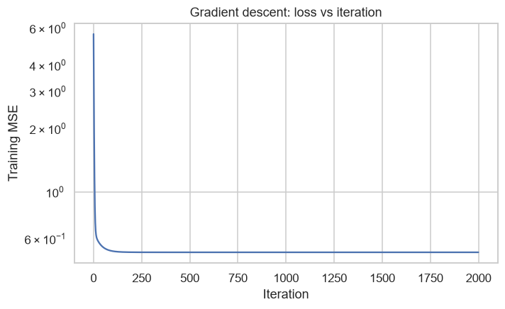
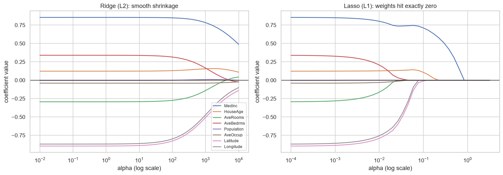
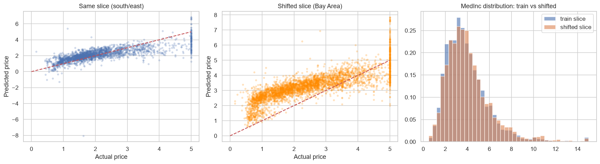

# 01 - Linear Regression: Zero to One

A complete, beginner-friendly deep dive into **linear regression**, built around a house price predictor on the **California Housing** dataset (`sklearn.datasets`). Everything lives in one runnable notebook: [`linear_regression.ipynb`](linear_regression.ipynb).

## Project overview
The notebook goes from "what is a line?" to confidently judging a model, in 8 steps:

1. **Theory in plain English**: regression, the line equation, squared error, cost function, gradient descent, and a step-by-step derivation of the normal equation.
2. **EDA**: distributions, correlations, outliers, geography, with notes on what each plot tells you.
3. **From scratch (NumPy only)**: normal equation and gradient descent, verified against scikit-learn.
4. **scikit-learn**: `LinearRegression`, Ridge and Lasso with cross-validated alpha, coefficient shrinkage plots.
5. **Assumption checks**: residual plots, Q-Q plot, Breusch-Pagan test, VIF, with a violation and its fix.
6. **Failure modes**: feature leakage and data drift, caused on purpose.
7. **Metrics**: MAE, RMSE, R-squared and when each one misleads.
8. **Practice**: 8 "prove it" questions, 3 coding exercises and an extension project (answers are intentionally not included).

## What I learned
- A line's weights can be found two ways: solving the **normal equation** `w = (XᵀX)⁻¹Xᵀy` directly, or walking downhill with **gradient descent**. Both give identical answers.
- Squared error is smooth and punishes big misses disproportionately (5x the error costs 25x the penalty), so outliers have a big influence.
- **Regularization** (Ridge/Lasso) does little with 16,000 rows and 8 features, but rescues a model with many junk features and few rows (test R² from 0.04 to 0.49 with Lasso).
- Fixing one assumption can create a new problem: the log-target model gave a *negative* R² until its extreme predictions were clipped.
- A great score can be a lie: a leaky feature gave **R² = 0.996**, which fell to about **0.01** once the leak was unavailable.
- Data drift hurts: the model's error grew 40% to 100% on shifted slices, and 500 representative rows restored much of the accuracy.
- Metrics each hide something: R² can be high on a wrong model, and the average error hides where the model fails.

## Key results
All numbers are on the held-out 20% test set (4,128 block groups); the target is in units of $100,000.

| Model | MAE | RMSE | R² |
|-------|-----|------|----|
| OLS (normal eq. = gradient descent = sklearn) | 0.5332 | 0.7456 | 0.5758 |
| Ridge (CV alpha = 0.001) | 0.5332 | 0.7456 | 0.5758 |
| Lasso (CV alpha = 0.0006) | 0.5332 | 0.7450 | 0.5765 |
| OLS on log(price), predictions clipped to 0-5 | 0.4919 | 0.7339 | 0.5890 |

| Failure-mode experiment | Result |
|---|---|
| Leaky feature | Test R² 0.996 in the notebook, 0.013 in simulated production |
| Drift: new → old neighborhoods | R² 0.615 → -0.199 |
| Drift: south/east → Bay Area | R² 0.561 → 0.212; adding 500 Bay Area rows gives 0.633 |
| Overfitting demo (68 features, 150 rows) | Test R²: OLS 0.039, Ridge 0.371, Lasso 0.489 |

## Plots
**Gradient descent converging**



**Ridge vs Lasso coefficient shrinkage**



**Data drift: the model over-predicts on an unseen region**



## How to run
```powershell
git clone https://github.com/Arnav-Shrivastava/linear-regression-zero-to-one.git
cd linear-regression-zero-to-one
python -m venv .venv
.\.venv\Scripts\Activate.ps1
pip install -r requirements.txt
jupyter notebook linear_regression.ipynb
```
On macOS/Linux, activate with `source .venv/bin/activate`. Run the cells from top to bottom. The first run downloads the California Housing dataset (it is cached afterwards).

## Folder structure
```
.
├── linear_regression.ipynb   # the full learning notebook (Steps 1-8)
├── images/                   # plots embedded in this README
├── requirements.txt          # Python dependencies
├── .gitignore
└── README.md
```
